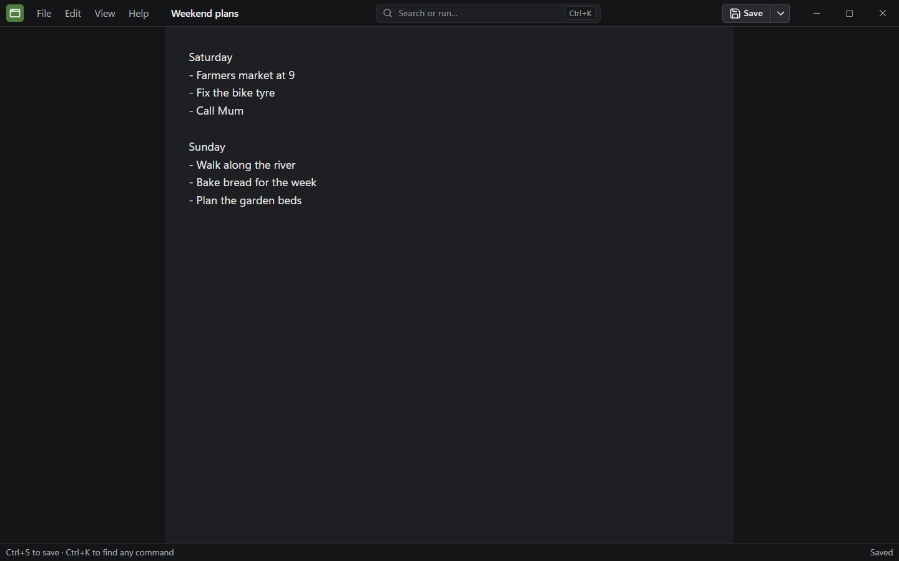
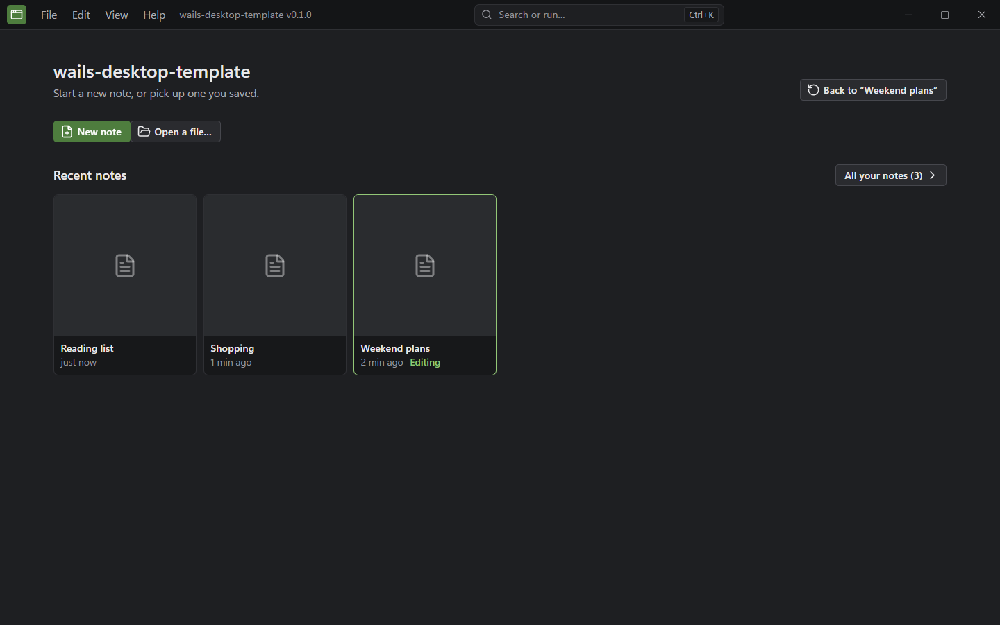

# wails-desktop-template

A starter for desktop apps that feel like desktop apps, built with
[Wails 3](https://v3.wails.io), React and TypeScript.



It comes with the parts every app needs sooner or later, already working and tested. When
a new app doesn't need one, deleting it takes minutes; adding it later would take weeks.
The example app keeps notes, and is the part a new app replaces.



## What's in it

| | |
|---|---|
| **Documents** | Save to a library or to any file, open, rename, copy, and **Recently removed**, which keeps what's removed for 30 days. A versioned file format that keeps keys it doesn't know |
| **Never lose work** | Undo and redo, an autosaved draft that comes back after a crash, and a question before closing with anything unsaved |
| **Library page** | Search, sort, groups by date, ticking several at once, keyboard moves, and pictures served from disk |
| **Backup** *(optional)* | To a .zip anywhere, to a folder by itself once a day, and to cloud storage the person already has (S3, R2, B2, Wasabi and others), with keys kept in the system's keychain. Restoring shows what's in a backup first and never replaces anything |
| **Export** *(optional)* | One document or many, in formats the app names, with progress and a question before replacing files |
| **Updates** | Checks GitHub releases weekly, downloads with a checksum, and installs on close. Windows through the installer, a Mac and a Linux AppImage through the Wails updater; a Linux package points to the download page |
| **A real window** | Frameless on Windows with its own buttons, an inset title bar on a Mac, the system's title bar on Linux, remembered size and place, one copy at a time, and closing or minimising to the tray (not on Linux, where GNOME shows no tray) |
| **Linux packages** | A .deb, .rpm, Arch package and AppImage, built and released by CI, and a test workflow that installs each on a clean Ubuntu, Debian, Fedora and Arch system, starts it and keeps a screenshot |
| **Settings** | A settings window with search, built from a list of settings; rebindable shortcuts; light and dark themes; interface scale |
| **Getting around** | A command palette for every command and setting, menus in the title bar, a status bar, What's new after an update |
| **Report a problem** *(optional)* | GitHub's issue forms asked in the app, with the version and system filled in |
| **Tour** *(optional)* | A short walk around each page, once by itself and any time from Help |

[Removing a feature](docs/removing-features.md) lists the steps for each optional one.

## Start a new app

1. Click **Use this template** on GitHub, and clone your new repository.
2. Install what it needs (below), then rename it:

   ```bash
   make install
   make rename NAME="Recipe Box" ID=recipe-box BUNDLE=com.you.recipebox REPO=you/recipe-box
   ```

   `NAME` is what people see. `ID` names the binary, the data folder, the keychain entry and
   release files. `BUNDLE` is how Windows and macOS know the app. `REPO` is where updates
   and issues come from. All four live in `appconfig/app.config.json`, and `make check`
   fails if any build file disagrees with it.
3. Replace the example: `frontend/src/example` is the note type, its editor, its export
   formats and its tour. `documentType` in `frontend/src/store/document-store.ts` says
   which document type the app uses.
4. Take out what you don't need, with [Removing a feature](docs/removing-features.md).
5. Replace the icon: `build/appicon.png` (1024×1024), `frontend/public/favicon.svg`, and
   `backend/tray-mac.png` for the Mac's menu bar. `wails3 task common:generate:icons` makes the
   Windows `.ico` and Mac `.icns` from the PNG. The Linux build draws its icons from
   `build/appicon.svg`, so replace that too.

## Build from source

You need Go 1.26 or later, Node.js, pnpm, [golangci-lint](https://golangci-lint.run/) and the
Wails 3 CLI at the version in `go.mod`:
`go install github.com/wailsapp/wails/v3/cmd/wails3@v3.1.0`. `wails3 doctor` should report
success. On Windows, `choco install make` provides `make`, which also needs Git for
Windows in its default folder.

```bash
make install    # Frontend packages and git hooks, first time only
make dev        # The app with hot reload
make web        # Only the interface, in a browser
make build      # Build the app into bin
make check      # Every lint, test and build check
make release    # The installer this computer can make
```

Run `make` to list every task. `make installer` builds the Windows installer (needs NSIS),
and `make dmg` the Mac disk image and update zip (needs a Mac).

On Linux, the app builds against GTK 4 and WebKitGTK 6 (Ubuntu 24.04, Debian 13, Fedora 40 or
later). On Debian and Ubuntu, install `build-essential pkg-config libgtk-4-dev
libwebkitgtk-6.0-dev librsvg2-bin`; then `wails3 task linux:package` makes the .deb, .rpm
and Arch package, and `wails3 task linux:appimage` the AppImage.

## How it's built

Go handles files, native dialogs, the window, the tray, backups, updates and secrets.
Documents are bytes to Go: every decision about them is made in TypeScript.

```
appconfig/              who the app is: name, id, bundle id, repository, version
build/                  each system's build files: Windows installer, Mac app, Linux packages
backend/                the core service: window, tray, close guard, dialogs, settings, draft, updates
backend/documents/      the library, its pictures and Recently removed
backend/backup/         backups to a file, a folder and the cloud      (optional)
backend/export/         writing an export's files                      (optional)
frontend/src/core/      pure code: the document file, undo, settings, commands' search
frontend/src/platform/  the only code that calls Go
frontend/src/shell/     the menu bar, palette, settings window, pages and the feature registry
frontend/src/features/  backup, export, report and tour, each removable
frontend/src/example/   the Notes example, which a new app replaces
```

[CONTRIBUTING.md](CONTRIBUTING.md) has the rules a change follows, and
[AGENTS.md](AGENTS.md) the same for coding agents.

## Releasing

`make version V=0.2.0`, a line in `CHANGELOG.md`, and a GitHub release tagged `v0.2.0`.
GitHub builds the Windows installer, the Mac DMG and zip, and the Linux .deb, .rpm, Arch
package and AppImage. [Releasing](docs/releasing.md) has the steps.

The builds aren't signed, so the first launch warns: on Windows choose **More info > Run
anyway**, and on a Mac open it from **System Settings > Privacy & Security**. A Linux
AppImage uses the system's graphics libraries and `bubblewrap`, as most desktops have. [Releasing](docs/releasing.md#signing) covers
signing.

## License

[MIT](LICENSE.md)
